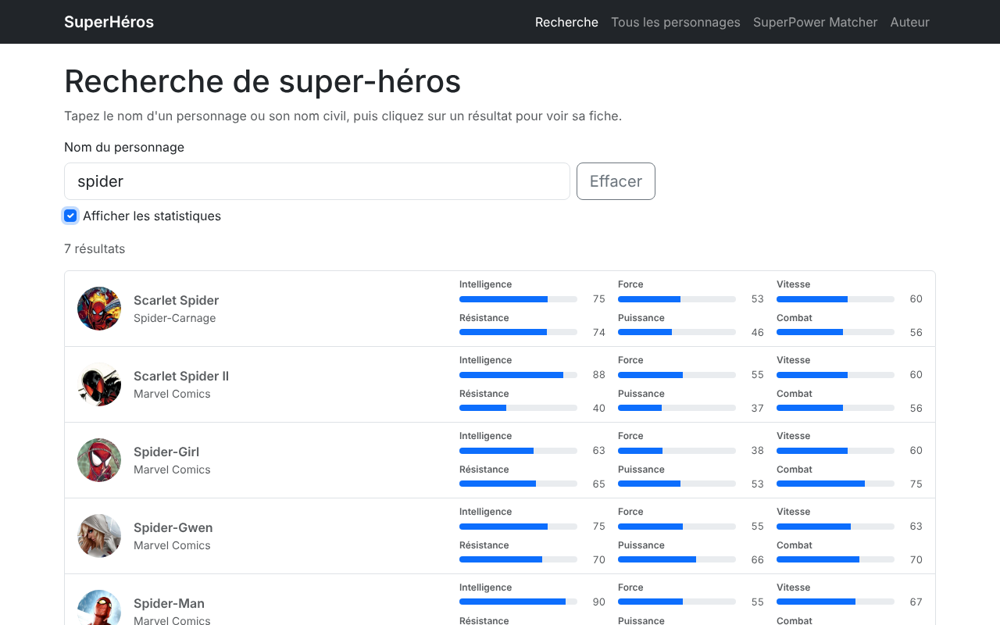
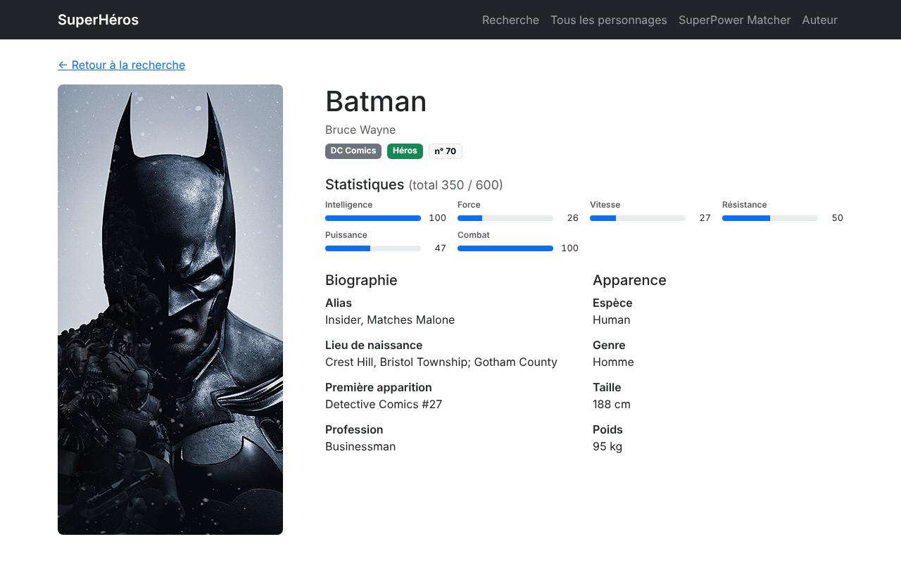
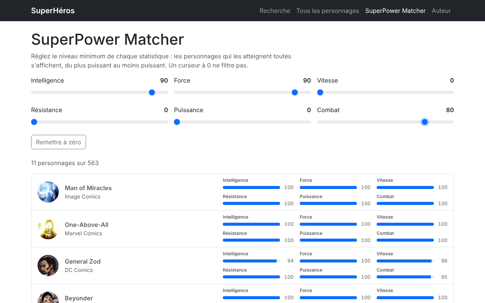

# SuperHéros – Vue.js

Application web pour rechercher, filtrer et comparer les 563 personnages de la [superhero-api](https://github.com/akabab/superhero-api) : statistiques de pouvoir, biographie, apparence. Elle utilise Vue.js 3 sans étape de build et est publiée sur GitHub Pages.

C'était le TP Vue.js du module Technologies de l'internet, en licence professionnelle DLWM, rendu en janvier 2025 et décrit dans le [compte rendu](docs/Compte_rendu_TP_VueJS.pdf). Je l'ai repris ensuite pour corriger les bugs du rendu et le compléter.

L'application est [en ligne ici](https://miscuitatlas.github.io/superheros-vue/).



## Les pages

- **Recherche** instantanée par nom de héros ou nom civil (« wayne » trouve Batman), sans tenir compte des accents ni des majuscules.
- **Liste complète**, filtrable par éditeur et par camp (héros, méchants, neutres), triée par nom ou par puissance totale.
- **Fiche** de chaque personnage : portrait, statistiques, biographie et apparence, avec un bouton « personnage au hasard ».
- **SuperPower Matcher** : un curseur par statistique fixe un niveau minimum, et les personnages qui les atteignent tous s'affichent, du plus puissant au moins puissant.

<table>
  <tr>
    <td></td>
    <td></td>
  </tr>
</table>

**Stack** : Vue.js 3 (Options API, composants et mixin) et Bootstrap 5.3 chargés depuis un CDN avec contrôle d'intégrité, API Fetch, tests avec `node:test`.

## Ce que j'ai corrigé

- **Matcher** : les curseurs renvoyaient du texte, et la recherche exigeait des niveaux exactement égaux, ce qui donnait presque toujours zéro résultat. Les curseurs fixent maintenant des minimums.
- **Navigation** : la barre ne s'affichait qu'avec un serveur local, et son menu ne s'ouvrait pas sur mobile parce que le JavaScript de Bootstrap n'était pas chargé.
- **Dépendances** : Vue et Axios étaient chargés sans version fixe (`axios@latest`), et Bootstrap en version alpha. Axios est remplacé par `fetch`, et les versions sont figées.
- **Code recopié** : le chargement des données et le formatage étaient dupliqués dans chaque page. Ils sont maintenant regroupés dans un fichier commun et testés.

## Installation

Rien à installer : il suffit d'ouvrir `index.html` dans un navigateur, avec une connexion Internet pour charger Vue, Bootstrap et les données. Pour servir le projet en local :

```bash
python3 -m http.server 8000     # http://localhost:8000
```

## Tests

```bash
npm test      # Node.js 18 ou plus récent, sans dépendance
```

12 tests sur la recherche, le matcher et les filtres.

## Structure

```
index.html  liste.html  details.html  matcher.html  auteur.html
css/style.css              styles de l'application
js/superheros.js           code commun : accès à l'API, recherche, filtres, composants Vue
js/pages/*.js              logique propre à chaque page
tests/                     tests de la recherche, du matcher et des filtres
docs/                      compte rendu du TP et captures d'écran
```

## Ce que j'ai appris

- **Figer ses dépendances** : charger `axios@latest` depuis un CDN, c'est exécuter le code que le CDN sert ce jour-là. Avec une version fixe et l'attribut `integrity` (SRI), le navigateur refuse un fichier modifié.
- **Les valeurs d'un formulaire arrivent en texte** : un curseur `<input type="range">` renvoie une chaîne, d'où les comparaisons fausses du matcher. `v-model.number` règle le problème.

## Données

Les personnages, statistiques et images proviennent de [superhero-api](https://github.com/akabab/superhero-api) (akabab), version statique de superheroapi.com. Les personnages appartiennent à leurs éditeurs respectifs.

## Auteur

Projet réalisé lors du TP Vue.js du module Technologies de l'internet, en licence professionnelle Développement Logiciel et Web Mobile (DLWM), puis retravaillé.

**Maxence Français** : [portfolio](https://miscuitatlas.github.io) · [LinkedIn](https://www.linkedin.com/in/maxence-fran%C3%A7ais-a039a2307/)
